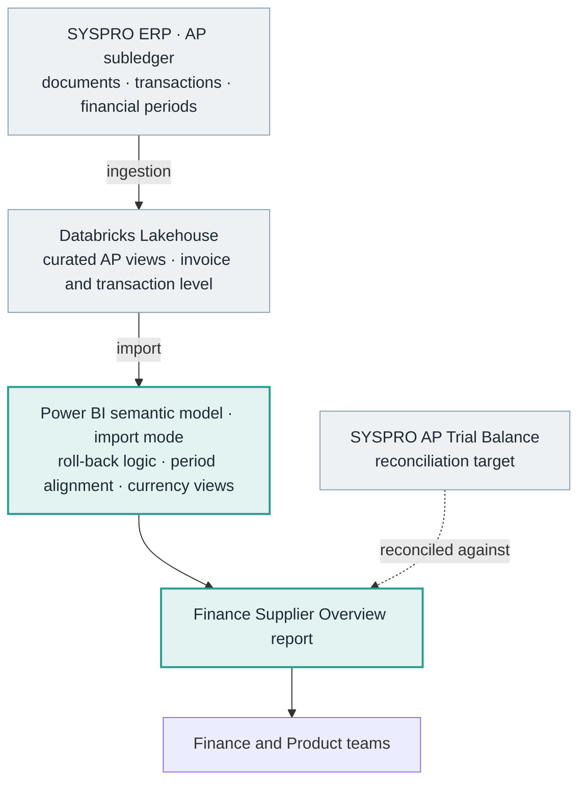
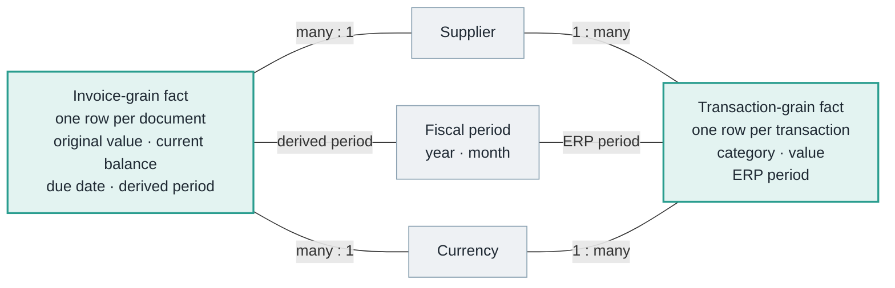
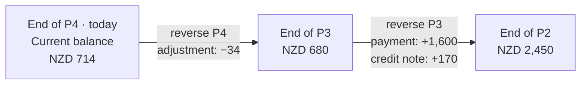
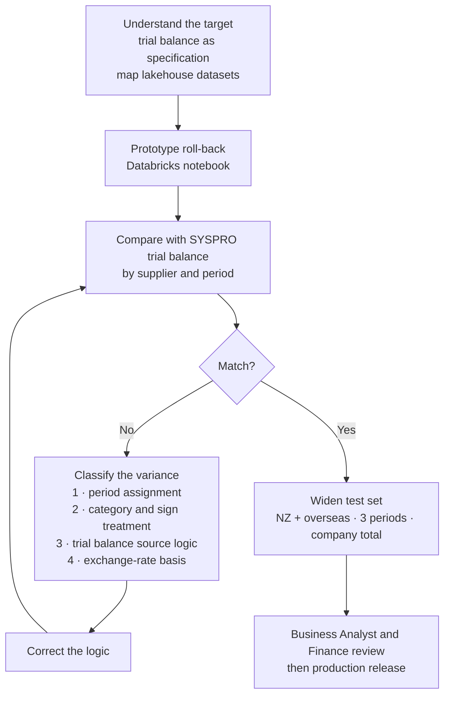

[← Portfolio](../../README.md) · [Finance](../README.md) · [Download PDF](AP-Supplier-Overview.pdf?raw=true)

# Reconstructing Historical Accounts Payable Balances in Power BI

### A case study in ERP reconciliation, fiscal-period alignment and multi-currency AP reporting

**Author:** Annamalai Kannan, BI Developer  
**Organisation:** Trends (Tuapeka Gold Print), New Zealand  
**Stakeholders:** Finance (requester and main user), Product team (user), Business Analyst (validation)  
**Stack:** SYSPRO ERP · Databricks Lakehouse · Power BI (import-mode semantic model, DAX)  
**Status:** In production

> **Confidentiality.** This case study describes methodology only. It contains no supplier names, financial values or record counts, and no code, queries or internal object names from the production solution. Every number in the examples and diagrams is fictional.

> **Evidence key.** I've kept three kinds of statement apart throughout:
>
> - **Verified:** confirmed by inspecting the production semantic model and report. This covers structure, calculation logic, and data checks that return only counts or true/false results.
> - **Author's account:** my own explanation of the development history, decisions and validation. None of this is visible in the finished model.
> - **Inferred:** a reasonable reading that I haven't independently confirmed. These are marked where they appear.

---

## Contents

- [Project at a Glance](#project-at-a-glance)
- [1. Executive Summary](#1-executive-summary)
- [2. Business Context](#2-business-context)
- [3. Requirements and Initial Investigation](#3-requirements-and-initial-investigation)
- [4. Data Architecture and Source Understanding](#4-data-architecture-and-source-understanding)
- [5. Technical Implementation](#5-technical-implementation)
- [6. Major Challenges and Resolutions](#6-major-challenges-and-resolutions)
- [7. Reconciliation and Validation](#7-reconciliation-and-validation)
- [8. Project Outcome](#8-project-outcome)
- [9. Technical and Professional Learnings](#9-technical-and-professional-learnings)
- [10. Future Considerations](#10-future-considerations)
- [Appendix: How the Technical Claims Were Verified](#appendix-how-the-technical-claims-were-verified)

---

## Project at a Glance

| Aspect | Summary |
|---|---|
| **Problem** | Finance needed supplier balances for any past month-end. The ERP's AP Trial Balance can only produce the current period and the two before it. |
| **Constraint** | The lakehouse held each invoice's current balance and the full transaction history, but no historical balance snapshots. |
| **Core idea** | Treat the trial balance as an accounting equation and run it backwards: start from today's subledger balance and reverse every movement posted after the selected period. |
| **Hard parts** | Matching the ERP's definition of a period; counting each ledger event exactly once across two datasets; matching the trial balance's own balance logic; keeping exchange-rate differences out of supplier balances. |
| **Validation** | NZ and overseas suppliers compared with the SYSPRO trial balance across the current and two prior periods (the range SYSPRO can produce), plus company total; reviewed by the Business Analyst and Finance. |
| **Outcome** | In production. Finance can view supplier balances for any period from 2023 onwards, in NZD and transaction currency. Reconciliation to the trial balance was confirmed for the periods SYSPRO can produce. |
| **My role** | Investigation, method design, semantic model, report, reconciliation and validation, from start to finish. The data engineering team had already brought the AP data into the lakehouse. |

---

## 1. Executive Summary

Finance needed to see supplier balances for any past month-end. SYSPRO's AP Trial Balance is the authoritative report for supplier balances, but it only produces the current period and the two before it. For anything older, someone had to rebuild balances by hand from transaction listings, or it couldn't be done at all.

I built the **Finance Supplier Overview** report in Power BI. Its main feature is a period-end balance for every supplier, for any selected fiscal period, in NZD and in the original transaction currency. In every period where SYSPRO's trial balance could be produced for comparison, it reconciled to it.

The difficulty was that the data didn't contain the answer directly. The lakehouse held each invoice's current outstanding balance and the transactions posted against invoices, but nothing about what any balance had been in the past. I designed a **roll-back method**: start from the current subledger balance and reverse, in a controlled way, every movement posted after the selected period. I worked out the logic myself in a Databricks notebook and then built it into the Power BI semantic model.

Getting the method to match SYSPRO exactly took several months. It meant understanding how SYSPRO assigns transactions to financial periods, how its trial balance arrives at a balance, which transaction categories move that balance and from which dataset, and how differences between the invoice and payment exchange rates show up in local-currency figures.

I validated the result against SYSPRO for a mix of New Zealand and overseas suppliers, across the current period and the two before it, and at company-total level. Those are the only periods SYSPRO can produce for comparison. The Business Analyst and the Finance team then reviewed and accepted it. The report is in production and used by both Finance and Product.

---

## 2. Business Context

### 2.1 The reporting gap

Accounts payable (AP) is the record of what a business owes its suppliers. Finance looks at AP in two ways:

- **Activity:** what was invoiced, paid or adjusted during a period. These are flows.
- **Position:** what is still owed at a point in time. This is a stock, the balance.

Activity is easy to slice by date, because every transaction has one. Position is not: a balance at a past date depends on every document and transaction up to that date, and on how the ledger treated each one.

SYSPRO's AP Trial Balance gives the position by supplier and invoice. *(Author's account)* It can only be run for the current period and the two before it. Finance asked for a way to look at supplier balances for **any chosen earlier period**, for supplier reviews, period comparisons and historical analysis, without rebuilding them from transaction listings.

### 2.2 Why this was a hard problem

The report itself is not complicated. Four features of the problem made it hard:

1. **The answer wasn't in the data.** No dataset held historical balances. Every past balance had to be derived, so any flaw in the method would produce a confident but wrong number.
2. **"Period" has a specific meaning in the ledger.** A transaction has several dates, and the financial period it is posted to doesn't always match any of them. Grouping by the wrong one gives totals that look right but don't match.
3. **One ledger event can appear in more than one dataset.** Credit notes, for example, exist both as documents and as transactions against other documents. Taking an event from both sides counts it twice; taking it from neither drops it.
4. **Two currencies, two rates.** A foreign-currency invoice is recorded in NZD at the rate when it is entered and paid later at a different rate. Use the wrong NZD value and the exchange difference ends up in the supplier balance.

Each of these produces a small error that is easy to miss. Combined, they make a reconstructed balance look plausible and still disagree with the ERP.

### 2.3 Why "close enough" isn't acceptable

A management dashboard can tolerate small rounding differences. A balance that Finance will compare against the ERP's own trial balance cannot. If the two disagree, even slightly, people stop trusting the report and go back to manual extracts. Exact reconciliation to SYSPRO was therefore the acceptance criterion from the start, not something to tidy up at the end.

### 2.4 The accounting concepts involved

The project relied on a working understanding of:

- **The AP subledger and the trial balance.** The trial balance is a roll-forward: opening balance, plus invoices and debit notes, minus credit notes and payments, plus or minus adjustments, revaluations and corrections, equals closing balance. Each category has its own sign and treatment.
- **Invoices and credit notes.** Credit notes reduce the liability. Depending on how the ERP records them, they can appear as negative documents rather than as separate transactions.
- **Debit and credit direction.** AP is a liability, so invoices increase it and payments reduce it. Source systems don't always store values with the sign the report needs.
- **Financial periods and calendar dates.** A transaction has a document date, an entry date and a posting period. The ledger assigns it to a financial period that doesn't always match the calendar month of any of those dates.
- **Foreign-currency invoices.** An overseas invoice is recorded in the supplier's currency and converted to the local currency (NZD). The rate when it is entered and the rate when it is paid usually differ, and the ledger has to account for that difference somewhere.
- **Adjustments and corrections.** Manual adjustments, reversals and balance corrections are legitimate ledger events. Leaving them out, or counting them twice, makes the balance wrong.

---

## 3. Requirements and Initial Investigation

### 3.1 Requirements

*(Author's account, supported by the delivered report)*

1. Show the AP balance per supplier, and in total, at the end of any selected fiscal period.
2. Match SYSPRO's AP Trial Balance at supplier level and company level.
3. Show values in both NZD and the original transaction currency.
4. Give context alongside the balances: invoice values, payment (spend) values, adjustments and credits for the selected period, plus a year-on-year spend comparison.
5. Show how the current balance is spread across ageing buckets.
6. Cover a historical window starting in 2023, which was three years at the time of delivery. The window then extends to whatever the current period is. Reconstructing the full ledger history was never a goal.

### 3.2 Using the trial balance as the specification

I started by reverse-engineering the report Finance already trusted, rather than the data. The AP Trial Balance was effectively the specification: if my numbers matched it, the solution was right. Looking at how it is laid out told me three things:

- **The report shows several timestamps.** Each line carries more than one date: when the document was raised, when it was entered or journalled, and transaction dates for payments. *(Author's account)* At first it wasn't clear which date decides whether an item belongs to a period. I resolved this by working through it with the Finance team. That is how I learned that period membership follows the ERP's **financial year and period**, not any single calendar date.
- **The balance is a roll-forward.** The report ends with a summary that takes the opening balance, adds period activity by category, and arrives at the ending balance. That told me exactly which movement categories exist, and that each one needed a deliberate decision.
- **Foreign amounts are converted at the rate when the invoice was entered.** The report's conversion setting values invoices in local currency at entry time. This turned out to be central to the exchange-rate work ([Section 6.5](#65-exchange-rate-differences-between-invoice-and-payment)).

### 3.3 Searching the lakehouse

The data engineering team had already brought SYSPRO's AP data into the Databricks lakehouse as curated reporting views. *(Author's account)* My job was to find out whether those views could support a historical balance and, if so, how.

What I found:

- An **invoice-level** dataset holds each document's original value and its **current** outstanding balance. Adding up current balances gives today's AP position, but there is no record of what the balance was at any earlier point.
- A **transaction-level** dataset holds every payment and other transaction posted against documents. Each one carries a transaction category, values in both currencies, and the ERP's financial year and period.

Neither dataset could answer the question alone. The invoice data knows *where we are now*. The transaction data knows *what happened, and when*.

### 3.4 The key insight

The trial balance summary is an equation: **opening + movements = closing**. If today's closing balance is known exactly, because it comes straight from the subledger, and every movement since period *T* is known, the equation can be rearranged to solve for the balance at *T*. That moved the problem from "find the missing historical data" to "classify and reverse the right movements correctly". It's a problem I could test and solve.

I developed this logic myself in a Databricks notebook, working directly from the data, before moving it into Power BI. *(Author's account)* Later I found that rolling balances backwards or forwards from a known, verified point is a standard audit procedure. That gave me independent confirmation that the approach was sound in accounting terms.

### 3.5 Alternatives, in hindsight

The table below sets out the alternatives and why the roll-back fits this problem better. *It's a retrospective comparison of the options, not a record of approaches I built and abandoned.*

| Approach | How it would work | Why it wasn't the right fit |
|---|---|---|
| **Periodic balance snapshots** | Store each supplier's balance at every period-end from now on | Only builds history going forward. It couldn't produce balances for 2023–2025, which was the main requirement. |
| **Build up from inception** | Add up every document and movement from the first ledger entry | Needs the full ledger history to be complete and correctly classified. Any gap or misclassification anywhere in the past affects every later balance. *(Verified: adding up all the history in the model doesn't land exactly on the current balance.)* |
| **Roll back from current balance** *(chosen)* | Start from the current subledger balance and reverse the movements after period *T* | Anchored to the ERP's own figure, needs only the history it reverses, and any error is limited to that window. |

---

## 4. Data Architecture and Source Understanding

### 4.1 High-level architecture and ownership

*Grey: systems that already existed (ERP, and lakehouse ingestion by the data engineering team). Teal: what I designed and built.*

*(Verified)* The model imports curated lakehouse views. The views already arrive in reporting shape, so Power Query does no more than set data types and remove a few columns. All the logic that matters for reconciliation lives in the semantic model.

*(Author's account)* The ingestion into the lakehouse already existed. Everything from the investigation onwards, including the method, model, report and validation, was my work.

### 4.2 Semantic model structure

*Generic names; the production model uses different identifiers. The two facts have no direct relationship: they meet only through the shared dimensions in the middle. Both facts hold values in transaction currency and NZD.*

*(Verified)* The model has two fact tables at different grains:

| Fact | Grain | Role in the solution |
|---|---|---|
| Invoice fact | One row per supplier invoice or credit document | Source of document values, the **current balance anchor**, due dates and ageing |
| Transaction fact | One row per transaction posted against a document | Source of **period movements**: payments, adjustments and other ledger events |

The two fact tables are deliberately **not related directly**. Each links to shared supplier, currency and fiscal-period dimensions, and the measures combine them through those dimensions. I chose this for three reasons:

- **Correct totals.** A document can have many transactions. Joining the facts directly would either inflate document values or force a many-to-many relationship, with its usual ambiguity.
- **Each fact keeps its natural time attribute.** The transaction fact uses the ERP's stored period. The invoice fact uses its derived period, with the limitation described in [Section 4.3](#43-aligning-two-time-structures). Both resolve to the same period dimension.
- **Simple measures.** Each measure reads one fact at its own grain, and the shared dimensions handle combining them. That makes every number easier to trace back when a reconciliation question comes up.

### 4.3 Aligning two time structures

This alignment was what made the reconciliation possible. It is exact on the transaction side and approximate on the invoice side, for the reason explained below.

- *(Verified)* The transaction fact carries the ERP's **financial year and period** directly.
- *(Verified)* The invoice fact has no such field. It has a date-style key, which I convert into the same fiscal year and period convention through a derived column.
- *(Verified)* A month-level fiscal-period table sits over both facts, so a single year and month selection filters documents and transactions through the same dimension. After alignment, the latest period in both facts is the same.

**Why the ERP's own period matters.** *Fictional example:* a supplier invoice is dated on the last day of one month, but it is entered after that period has closed in the ledger, so it's posted into the next period. A report grouped by document date puts it in the earlier month. The trial balance puts it in the later one. Both periods are then wrong by the same amount, in opposite directions. That's exactly the kind of variance that looks like noise until you check across period boundaries.

*(Verified, while reviewing for this case study)* The transaction data holds both a date-style key and the ERP's stored period, so I used it to test the conversion. Applied to the transactions, it reproduces the ERP's stored period for the large majority of rows, but not all of them. The remainder were posted to a period other than the one their date implies. This confirms that the conversion convention is right, and that the ERP's stored period is the authority wherever it exists. That's why the transaction side uses the stored period directly.

> **Known limitation: invoice-side periods.** Documents in the invoice-level data don't carry the ERP's stored period, so their period is derived from a date. The test above shows that a date-derived period doesn't always match the posting period. A document posted into a different period than its date implies can therefore fall into a different period in this report than in SYSPRO. The current balance anchor isn't affected, because it doesn't depend on periods. The effect is limited to how invoice values are split across periods, which feeds into the roll-back. The tested window reconciled ([Section 7](#7-reconciliation-and-validation)), but the derived-period approach doesn't guarantee an exact match for every document in every period. Bringing the stored period through at source would remove this limitation ([Section 10](#10-future-considerations)).

### 4.4 Defining "today"

*(Verified)* The roll-back needs a reference point for "now". The model takes this as the latest fiscal period found in **either** fact table, not the system date. As a result, the reconstruction always lines up with the data that has actually been loaded, even if a refresh is late or the report is opened between periods.

### 4.5 Report layer

*(Verified from the report)* The report has four pages, all sharing supplier, fiscal year and fiscal month slicers:

- **Home:** headline cards for invoice value, spend and balance in NZD and transaction currency; a monthly spend trend against the previous year; spend by supplier class; and top-supplier rankings by spend and by balance. Card titles show the selected period.
- **Invoice Analysis:** invoice and credit values for the period, with document-level detail.
- **Spend Analysis:** payments and adjustments for the period, with transaction-level detail by category and currency.
- **Due Date Analysis:** the current balance split into not-yet-due and overdue buckets (0–30, 31–60, 61–90 and 90+ days), with document-level detail.

---

## 5. Technical Implementation

The production calculations aren't reproduced here. This section explains the method, shows it working on fictional data, and explains the reasoning behind each design decision.

### 5.1 The roll-back period method

A trial balance rolls **forward**:

> Closing balance = Opening balance + invoices − payments ± adjustments …

I rearranged that relationship to roll **backward**:

> Balance at end of *T* = Current balance − (net movement in every period after *T*, up to now)

Each movement is undone in its accounting direction. Documents raised after *T* are taken off, because they didn't exist at *T*. Payments made after *T* are added back, because at *T* that money was still owed. Adjustments are reversed according to their sign.

#### Worked example (fictional)

One overseas supplier invoices in USD. The local currency is NZD. Today is the end of period P4.

| Period | Event | USD | Rate when entered | NZD in ledger |
|---|---|---:|---:|---:|
| P1 | Invoice A | 1,000 | 1.60 | 1,600 |
| P2 | Invoice B | 500 | 1.70 | 850 |
| P3 | Payment of Invoice A (paid at a rate of 1.65) | −1,000 | *invoice rate 1.60* | −1,600 |
| P3 | Credit note against Invoice B | −100 | 1.70 | −170 |
| P4 | Adjustment to Invoice B | +20 | 1.70 | +34 |

Today's subledger balance is Invoice B's remaining USD 420 × 1.70 = **NZD 714**. Rolling back:

Check: at the end of P2, both invoices were open and unpaid. 1,600 + 850 = **2,450**. ✓

In the model, this is a single balance measure that responds to the period slicer. *(Verified)* Choosing a year and month moves the anchor point. The measure takes the current balance, ignoring the period filter but respecting the supplier and currency filters, and then applies the net movement for every period after the selected one. Selecting the latest period returns exactly the current balance, in both currencies. I confirmed this as a consistency check while reviewing for this case study.

#### Where it can go wrong

Using the same fictional data, these are the two failure modes that cost the most effort to find. [Section 6](#6-major-challenges-and-resolutions) covers them in detail.

| Mistake | Effect on the P2 balance | Result |
|---|---|---:|
| Payment valued at the payment-date rate (1.65) instead of the invoice rate | +1,650 instead of +1,600 | 2,500 (overstated by the exchange difference) |
| Credit note counted from both datasets | +170 reversed twice | 2,620 (overstated by the credit) |
| **Correct treatment** | | **2,450** |

Both wrong results look reasonable on their own. They only show up when compared line by line with the ERP.

#### Why this design

- **It is anchored to the ERP.** The starting point is SYSPRO's own current subledger balance, so the reconstruction inherits the ERP's treatment of everything that has already happened. Any error is limited to the movements reversed, not built up over the whole history.
- **It only needs the history it reverses.** Covering the required window, from 2023 to the current period, only needs complete movements for those years.
- **It matches an accepted audit technique.** Rolling a verified balance backwards or forwards is standard practice in audit, which is reassuring for the accountants who rely on the numbers.

### 5.2 Classifying movements: each event counted exactly once

The trial balance splits period activity into categories: invoices, debit notes, credit notes, adjustments, disbursements, revaluations and balance corrections. The transaction data has categories of its own. For each one I had to decide whether it moves the balance, and from which dataset.

The rule I worked to: **every ledger event affects the reconstructed balance exactly once, from the dataset that represents it most faithfully.**

*(Verified, while reviewing for this case study)* The model's evidence matches that rule:

- **Documents** (invoices, and credit and debit notes recorded as documents) come from the invoice-level data. In the transaction data, most credit-note entries can be matched to negative documents in the invoice data, and most debit-note entries to documents there too. Counting those categories from the transaction side as well would have double-counted them.
- **Payments and adjustments** come from the transaction-level data, where they occur at their own grain. Adjustments include both increases and decreases, and the model keeps both directions.
- **Revaluation entries** carry no value in local currency. That's consistent with the ERP valuing invoices at the rate when they were entered, so they have no effect on the NZD balance.

The exact category mapping is part of the proprietary implementation and isn't listed here. The key point is that it was **worked out from the trial balance's own roll-forward**, not assumed from category names.

### 5.3 Sign conventions

*(Verified)* The source stores some movements with the opposite sign to the one the report needs. For example, payments reduce the liability but arrive as negative values. I settled on one convention, **positive equals amount owed**, and applied it consistently to every measure, so that documents, payments, adjustments and balances can be added and subtracted directly.

That sounds trivial, but sign errors are one of the most common reasons a rebuilt balance looks plausible and is still wrong. Most importantly, the reversal step in the roll-back only works if every movement already has its correct accounting direction.

### 5.4 Two currency views

*(Verified)* Every financial measure exists twice: once in NZD and once in the original transaction currency. No conversion happens in Power BI:

- NZD values come from the ledger exactly as SYSPRO recorded them.
- The model deliberately leaves out exchange-rate attributes, so no one can accidentally recalculate historical NZD values using today's rates.
- Open foreign-currency balances are carried at the original invoice rate in almost every case. That matches the trial balance's conversion setting.

### 5.5 Supporting analytics and a deliberate trade-off

- **Year-on-year spend:** monthly payments set against the same fiscal period a year earlier.
- **Ageing:** the current open balance per document is grouped by days relative to the due date.
- **Context-aware labelling:** card titles show the selected fiscal year or period, or say "Multiple Periods", so a reader always knows what time frame a number covers.

*(Author's account)* Ageing is shown for the **current** position only. Running the roll-back document by document, for every historical period, and then ageing each reconstructed balance would have been too expensive computationally for an interactive report. The historical balance requirement didn't depend on it, so I limited ageing to the current position (see [Section 10](#10-future-considerations) for a possible extension).

---

## 6. Major Challenges and Resolutions

### 6.1 How I isolated discrepancies

*(Author's account)* Early versions of the roll-back didn't match SYSPRO. A single aggregate variance tells you very little, so I compared at the **supplier and period** level and checked which kind of supplier and which period each difference appeared in.

Picking test suppliers deliberately made this possible. Each kind of mistake leaves a different pattern in the variances, so comparing domestic and overseas suppliers side by side, across several periods, separated causes that would otherwise be mixed into one total. The sections below follow the four types of variance in the diagram.

### 6.2 No historical balances in the source

**Challenge.** The lakehouse held only today's document balances and a transaction history. Every historical balance had to be worked out.

**Approach.** I studied the two datasets until I understood how they relate: the current document balance, plus the movements that produced it. I built and tested the roll-back logic in a Databricks notebook first, and moved it into the semantic model afterwards. *(Author's account)* That phase took several months of trying ideas and comparing results.

**Resolution.** The roll-back method in [Section 5.1](#51-the-roll-back-period-method).

### 6.3 Period assignment: working out what "period" means

**Challenge.** The trial balance shows several dates for every line, and none of the calendar dates on its own reliably decided which period an item belonged to. Grouping by the wrong one moves items across period boundaries, the pattern shown in the fictional example in [Section 4.3](#43-aligning-two-time-structures).

**Diagnosis.** *(Author's account)* Working with the Finance team, I learned how SYSPRO assigns transactions to financial periods: by the ledger's posting period, which isn't always the period of any date printed on the document. I then located the ERP's financial year and period fields in the lakehouse.

**Resolution.** Every transaction is assigned to its **ledger period** directly. Documents, which don't carry that field, go through a conversion to the same convention ([Section 4.3](#43-aligning-two-time-structures)). A single fiscal-period dimension applies the selection to both. The derived period on the document side is the one remaining approximation in the period logic ([Section 4.3](#43-aligning-two-time-structures)).

### 6.4 Matching the trial balance's own balance logic

**Symptom.** Even with correct periods and movements, some balances still didn't match.

**Diagnosis.** *(Author's account)* The cause was that SYSPRO's trial balance takes its balances from a particular underlying table using its own logic, and the curated views didn't reflect that logic exactly.

**Resolution.** I traced how the trial balance arrives at its figures and repeated that logic in my calculation, rather than relying on how the curated views represent it. The details are proprietary and left out here. The lesson applies more generally: when a report is the reconciliation target, match its logic, not the meaning a column name implies.

### 6.5 Exchange-rate differences between invoice and payment

**Symptom.** *(Author's account)* Differences between the invoice-date and payment-date exchange rates were causing my balances to differ from SYSPRO's. Testing NZ and overseas suppliers together is what made it possible to separate this cause from the others.

**Diagnosis.** A foreign-currency invoice is recorded in NZD at the rate when it is entered. It's paid later at a different rate. The difference between those two NZD amounts is a realised exchange gain or loss, which the ledger accounts for separately and **not** in the supplier balance. The transaction data holds more than one NZD value for a payment, so it matters which one the roll-back reverses.

*(Verified, while reviewing for this case study)* For foreign-currency payments, the NZD value the roll-back uses is at the **original invoice rate** for all but a handful of transactions. The other NZD value on the same transactions reflects the rate when paid. Open foreign balances are likewise carried at the invoice rate. Both match the trial balance's conversion basis.

**Resolution.** Every movement in the roll-back is valued on the **same rate basis as the subledger balance**, so the exchange difference doesn't leak into supplier balances. The worked example in [Section 5.1](#51-the-roll-back-period-method) shows the effect: using the payment-date rate overstates the earlier balance by exactly the exchange difference. Once I made this change, overseas suppliers reconciled as well.

### 6.6 Credits, adjustments and other ledger events

**Symptom.** A variance can come from any of the categories in the trial balance roll-forward: credit notes, debit notes, adjustments, revaluations and corrections.

**Approach.** I used the trial balance's own roll-forward as a checklist and worked out each category's effect on supplier balances, including whether it was already represented in the document-level data.

**Resolution.** Each category is included exactly once, from the right source and with the right sign ([Section 5.2](#52-classifying-movements-each-event-counted-exactly-once)). Categories with no value in local currency under the ERP's conversion basis are left out on purpose, not by oversight.

---

## 7. Reconciliation and Validation

### 7.1 Business validation

*(Author's account)*

| Validation layer | Method |
|---|---|
| **Supplier-level reconciliation** | Six suppliers, deliberately a mix of New Zealand and overseas (multi-currency) suppliers, compared with the SYSPRO AP Trial Balance. |
| **Period coverage** | Each test supplier checked for the **current period and the two prior periods**, the full range SYSPRO can produce, so the roll-back was tested at several depths. |
| **Company-level reconciliation** | Total AP balance compared with the trial balance's company total. |
| **Domestic vs foreign split** | Running NZD and foreign suppliers side by side meant exchange-rate problems could be separated from period or category problems. |
| **Stakeholder sign-off** | The Business Analyst and Finance team reviewed the results before release. |

The reasoning behind the test design: SYSPRO can only produce the trial balance for three periods, so those three periods are the only ones that can be checked directly. Choosing a mix of suppliers, especially multi-currency ones, tested every part of the logic within that window: period alignment, category treatment, sign handling and exchange-rate basis.

**What the validation does and doesn't establish.** Reconciliation was confirmed for the tested suppliers, the company total, and the current period and two prior periods. Older periods back to 2023 can't be compared with the SYSPRO trial balance, because SYSPRO can't produce it for them, so they haven't been independently reconciled. They use the same method, applied to a longer run of reversed movements. That gives good grounds for confidence, but it isn't the same as having checked each of them against the ERP. Two things can grow with depth: the invoice-side period approximation ([Section 4.3](#43-aligning-two-time-structures)), and any misclassified movement in the older history. An automated check against archived trial balance outputs would extend the evidence over time ([Section 10](#10-future-considerations)).

### 7.2 Structural safeguards in the model

*(Verified)*

- Both facts are filtered through one fiscal-period dimension: the ERP's stored period on the transaction side, and a derived period on the document side (see the limitation in [Section 4.3](#43-aligning-two-time-structures)).
- "Now" comes from the data rather than the system clock.
- NZD values are never recalculated from current rates, and no exchange-rate attributes are exposed.
- At the latest period, the reconstructed balance equals the current subledger balance exactly, in both currencies.

---

## 8. Project Outcome

*(Verified from the model and report; usage per author's account)*

**The main change:** historical supplier balances were previously available only for the current period and the two before it, through the SYSPRO trial balance. They are now available for **any fiscal period from 2023 to the present**. They have been reconciled to the trial balance for the current and two prior periods. Older periods use the same method but can't be compared with SYSPRO directly ([Section 7.1](#71-business-validation)).

Delivered alongside it:

| Capability | What the report provides |
|---|---|
| **Period-end balances** | Per supplier and in total, for any selected fiscal period |
| **Currency views** | NZD and transaction currency side by side |
| **Period activity** | Invoices, credits, spend and adjustments for the selected period |
| **Trend** | Monthly spend compared with the same period in the previous year; spend by supplier class |
| **Detail** | Interactive document- and transaction-level detail by supplier, category and currency |
| **Ageing** | Current-position ageing buckets with document detail |

The report is in production and used by the Finance and Product teams. Finance is no longer limited to the ERP's three-period trial balance when looking at historical supplier positions.

I don't have measured time savings, so I haven't stated any.

---

## 9. Technical and Professional Learnings

- **Reconciliation starts from the report people already trust, not from the data.** Reading the structure of the SYSPRO trial balance, especially its roll-forward summary and conversion settings, told me more about what the data meant than the source field names did.
- **Accounting identities can be rearranged into model logic.** Seeing the trial balance as an equation, and running it in reverse, turned a missing-data problem into a classification problem I could test.
- **Time is a business definition, not a column.** Financial period, document date and entry date answer different questions. Agreeing on which one governs a balance was a conversation with Finance before it was a modelling decision.
- **Grain discipline.** Keeping document-level and transaction-level facts separate, joined only through shared dimensions, avoided double-counting and kept each measure simple to reason about.
- **Exchange-rate handling is about consistency, not conversion.** The right answer wasn't to convert anything. It was to make sure every value used came from the same rate basis as the ledger balance.
- **Design test cases that separate causes.** Choosing domestic and foreign suppliers side by side, across several periods, separated causes that would otherwise have been mixed into one variance.
- **Working with Finance.** Several of the key breakthroughs came from conversations with Finance, not from the data alone.
- **Performance trade-offs are design decisions.** Limiting ageing to the current position kept the report responsive. Applying the roll-back at document level across every period would have cost far more than it added.
- **Prototype where it's cheap to change.** Building the logic in a notebook first kept iterations fast. The semantic model got a method that had already been tested.

---

## 10. Future Considerations

*These are possible improvements, not completed work.*

- **Historical ageing.** Extend the roll-back to document level so ageing can be shown as at a past period. This would probably need pre-aggregated period snapshots built in the lakehouse rather than calculated live in the report.
- **Ledger period for documents at source.** Bring the ERP's stored posting period through to the document-level data, so documents no longer rely on a derived period. That would match the treatment already used for transactions and remove the remaining dependency on a conversion.
- **Move derived logic upstream.** Period derivation and parts of the movement classification could live in the lakehouse, so other AP and finance reports can reuse them.
- **Automated reconciliation checks.** Turn the manual supplier and company comparisons into a scheduled check against SYSPRO trial balance extracts, with an alert when the variance goes over a tolerance. Keeping each month's trial balance output would, over time, build a record of independently reconciled periods beyond SYSPRO's three-period window.
- **Transaction-currency totals.** Transaction-currency balances only make sense within a single currency. When several currencies are selected, the report could hide the total or warn the user.
- **Model hygiene.** Turn off automatic date tables, remove unused dimensions, and add descriptions to measures for easier handover.

---

## Appendix: How the Technical Claims Were Verified

While this case study was being prepared, the production semantic model was re-inspected with model-inspection tooling. I didn't export any business records. Data-level checks returned only row counts or true/false results, and none of them are reproduced here.

| Claim | How it was checked |
|---|---|
| Two facts at different grains, joined only through shared dimensions | Model relationships inspected |
| Roll-back anchored on the current balance, reversing later movements | Measure logic inspected; latest-period result equals current balance in both currencies |
| Transaction side uses the ERP's stored period; documents use a derived period on the same convention | Column logic inspected; the conversion tested against the stored period on transaction data |
| Credit- and debit-note transactions largely correspond to documents in the document-level data | Matched by document reference and supplier, counts only |
| Foreign payments reversed at the original invoice rate | Implied rates compared with each document's original rate, counts only |
| Open foreign balances carried at the original invoice rate | Implied rates compared, counts only |
| Revaluation entries carry no local-currency value | Count of non-zero entries |
| No currency conversion in Power BI; exchange rates not exposed | Power Query steps and measures inspected |

Development history, validation practice and stakeholder involvement come from my own account. They can't be seen in a finished model.

---

*This case study describes work I carried out at Trends (Tuapeka Gold Print) and is published with the organisation's permission. It contains no proprietary data, code or business records.*
