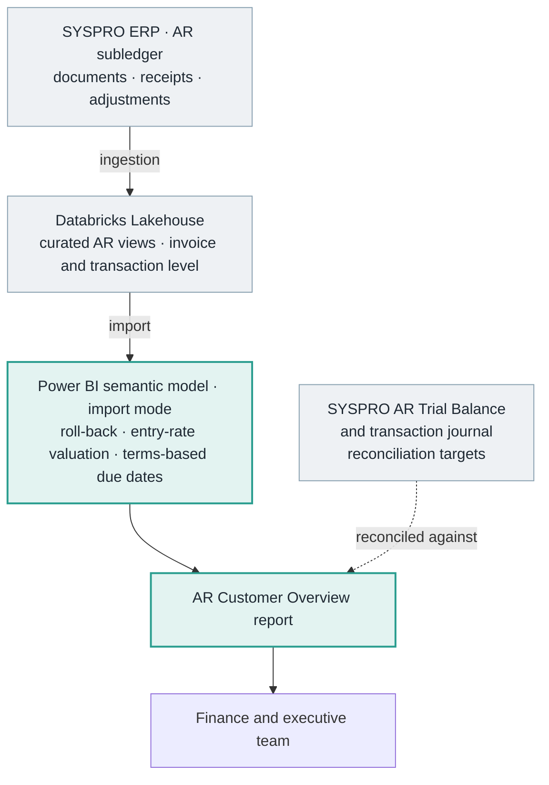
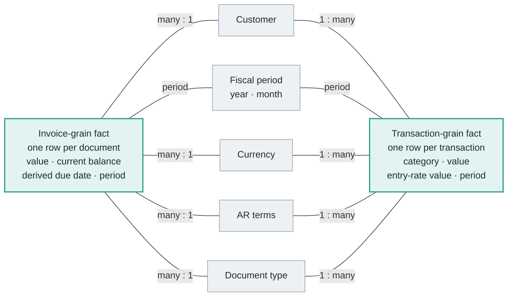
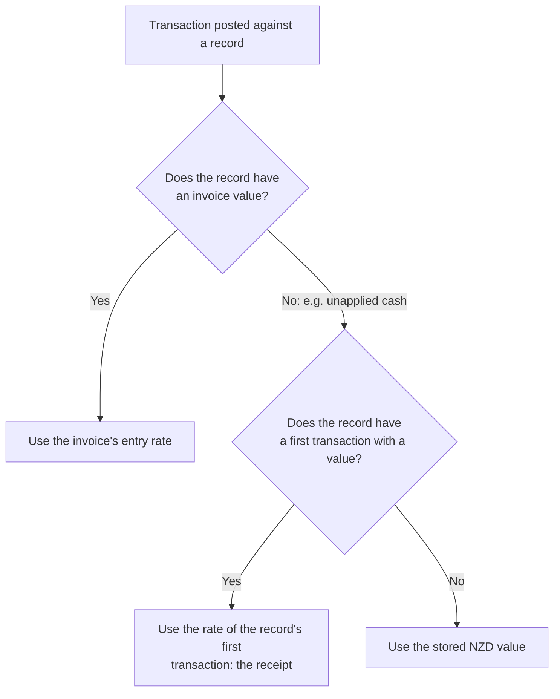
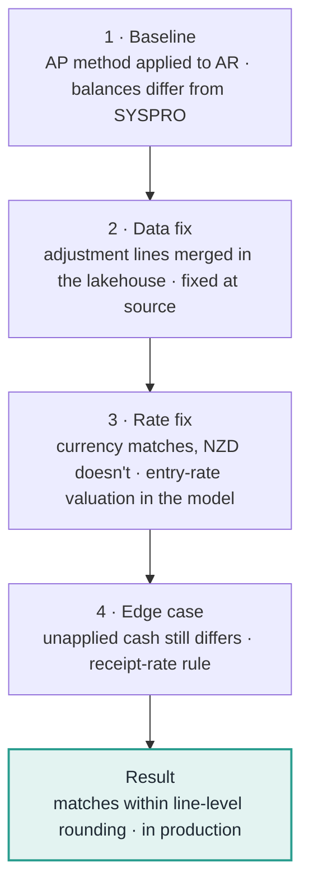

[← Portfolio](../../README.md) · [Finance](../README.md) · [Download PDF](AR-Customer-Overview.pdf?raw=true)

# Historical Accounts Receivable Balances at the ERP's Entry Rate

### A case study in reusing a reconciliation method, finding a lakehouse grain defect, and rebuilding exchange-rate logic in a Power BI model

**Author:** Annamalai Kannan, Junior BI Analyst  
**Organisation:** Trends (Tuapeka Gold Print), New Zealand  
**Stakeholders:** Finance (requester and main user), executive team (users)  
**Stack:** SYSPRO ERP · Databricks Lakehouse · Power BI (import-mode semantic model, DAX)  
**Status:** In production  
**Version:** 1 · October 2026

> **Confidentiality.** This case study describes methodology only. It contains no customer names, financial values or record counts, and no code, queries or internal object names from the production solution. Every number in the examples and diagrams is fictional.

> **Evidence key.** I've kept three kinds of statement apart throughout:
>
> - **Verified:** confirmed by inspecting the production semantic model and report. This covers structure, calculation logic, and data checks that return only counts or true/false results.
> - **Author's account:** my own explanation of the development history, decisions and validation, including the change notes I wrote at the time.
> - **Inferred:** a reasonable reading that I haven't independently confirmed. These are marked where they appear.

> **Companion case study.** This project builds on the roll-back method described in the [AP Supplier Overview case study](../ap-supplier-overview/README.md). This document explains that method briefly and concentrates on what was different, and harder, for receivables.

---

## Contents

- [Project at a Glance](#project-at-a-glance)
- [1. Executive Summary](#1-executive-summary)
- [2. Business Context](#2-business-context)
- [3. Approach](#3-approach)
- [4. Challenge 1: A Grain Defect in the Lakehouse](#4-challenge-1-a-grain-defect-in-the-lakehouse)
- [5. Challenge 2: Valuing Receipts at the Entry Rate](#5-challenge-2-valuing-receipts-at-the-entry-rate)
- [6. Other Design Decisions](#6-other-design-decisions)
- [7. Reconciliation and Validation](#7-reconciliation-and-validation)
- [8. Project Outcome](#8-project-outcome)
- [9. Learnings and Future Considerations](#9-learnings-and-future-considerations)

---

## Project at a Glance

| Aspect | Summary |
|---|---|
| **Problem** | Finance needed customer balances for any past month-end, with filtering by customer payment terms. SYSPRO's AR Trial Balance only produces the current period and the two before it. |
| **Starting point** | I had already built a historical balance method for accounts payable. AR had the same two kinds of lakehouse data: invoice-level documents and transaction-level receipts and adjustments. |
| **What went wrong at first** | Reusing the AP method as it stood didn't match SYSPRO. Two separate causes: adjustment lines being merged in the lakehouse, and receipts valued at the wrong exchange rate. |
| **Key work** | Found the adjustment-line defect and had it fixed at source; rebuilt SYSPRO's entry-rate valuation in the model, including a separate rule for unapplied cash. |
| **Result** | Historical balances match SYSPRO's AR Trial Balance to within line-level rounding for the five customers tested across the current period and the two prior periods, in both currencies. |
| **Outcome** | In production, used by Finance and the executive team. |
| **My role** | Investigation, diagnosis, method, model, report and validation. The data engineering team owns the lakehouse ingestion and fixed the defect I reported. |

---

## 1. Executive Summary

After the AP Supplier Overview went live, Finance asked for the same capability for accounts receivable: customer balances as at any past month-end, which SYSPRO's AR Trial Balance can't produce beyond the current and two prior periods. They also wanted to filter by customer payment terms.

I built the **AR Customer Overview** report in Power BI, reusing the **roll-back method** I had developed for AP: start from each document's current balance and reverse every movement posted after the selected period.

That method gave the right structure but not the right numbers. Getting AR to reconcile meant solving two problems that hadn't come up in AP:

1. **A grain defect in the lakehouse.** Adjustment entries that shared a document number but sat on different lines were being merged into one row, so one line's value was lost. I traced this, showed the data engineering team exactly where it happened, and they fixed it at source.
2. **The exchange rate used for receipts.** Balances in transaction currency matched SYSPRO, but NZD balances for foreign-currency customers didn't. SYSPRO values receivables at each invoice's **entry rate** and posts the exchange difference to the general ledger. The AR data, unlike the AP data, only held receipts at the rate on the day they were received. I rebuilt the entry-rate value in the model, with a separate rule for unapplied cash, which turned out to need the receipt's own rate.

After these fixes, NZD balances for the five customers I tested, across the current period and the two before it, matched SYSPRO's AR Trial Balance to within line-level rounding. The report is in production and used by Finance and the executive team.

---

## 2. Business Context

### 2.1 What Finance needed

Accounts receivable (AR) is what customers owe the business. Like AP, it can be viewed as activity (invoiced, received, adjusted) or as a position at a point in time. Finance needed the position, by customer, for any past period, and the ability to split it by **customer payment terms**.

### 2.2 How AR differs from AP

The roll-back method transfers between the two ledgers, but the details don't:

| | Accounts payable | Accounts receivable |
|---|---|---|
| **Direction** | Liability: what we owe | Asset: what we're owed |
| **Cash movement** | Payments to suppliers | Receipts from customers |
| **Exchange-rate value in the source** | Transactions already held at the invoice rate *(verified in the AP model)* | Transactions held at the transaction-date rate only *(author's account; verified that the model rebuilds the invoice rate)* |
| **Scale** | Smaller transaction volume | A much larger volume of documents and receipts |

AR also has **unapplied cash**: customers often pay before the receipt is matched to their invoices, so the cash sits on the account unapplied for a time. That, and the exchange-rate value available in the source, ended up driving most of the work.

---

## 3. Approach

### 3.1 Reusing the AP method

*(Author's account)* I built AR after AP and started by applying the same method and model structure, which is the sensible first step when the ledgers have the same shape. It gave me a working baseline within the same architecture, and every discrepancy after that pointed to something specific to AR rather than to the method.

*Grey: systems that already existed (ERP, and lakehouse ingestion by the data engineering team). Teal: what I designed and built.*

### 3.2 The roll-back method in brief

> Balance at end of *T* = Current balance − (net movement in every period after *T*, up to now)

Invoices raised after *T* are taken off. Receipts after *T* are added back, because at *T* the customer still owed that money. Adjustments are reversed according to their sign. The [AP case study](../ap-supplier-overview/README.md) explains the reasoning, the alternatives, and why anchoring to the ERP's current balance limits errors to the window being reversed.

*(Verified)* The AR model applies the same structure:

- One balance measure responds to the period slicer.
- "Now" is the latest period in either fact table.
- At the latest period, the rebuilt balance equals the current subledger balance exactly, in both currencies.

### 3.3 The model

*Generic names; the production model uses different identifiers. As in AP, the two facts meet only through shared dimensions.*

*(Verified)* Compared with AP, the AR model adds:

- an **AR terms** dimension, which drives the terms filter and the due-date calculation
- a **document type** dimension
- a **calculated entry-rate value** on every transaction ([Section 5](#5-challenge-2-valuing-receipts-at-the-entry-rate))
- a **refresh timestamp in New Zealand local time** ([Section 6.2](#62-due-dates-from-payment-terms-aged-in-new-zealand-time))

---

## 4. Challenge 1: A Grain Defect in the Lakehouse

### 4.1 Symptom

*(Author's account)* With the AP method applied, some customers' rebuilt balances didn't match SYSPRO's AR Trial Balance.

### 4.2 Diagnosis

I narrowed the differences down to **adjustment entries**. In SYSPRO, one document can carry several adjustment lines that share the same document number and are told apart by a line number. In the lakehouse, those lines were being **collapsed into one row**: one line's value overwrote the others instead of being kept alongside them.

**Fictional example:**

| Source (SYSPRO) | Document | Line | Adjustment (NZD) |
|---|---|---|---:|
| | DOC-1001 | 1 | +40.00 |
| | DOC-1001 | 2 | −15.00 |
| | **Net effect** | | **+25.00** |

| Lakehouse (before fix) | Document | Adjustment (NZD) |
|---|---|---:|
| | DOC-1001 | +40.00 *(line 2 lost)* |

The rebuilt balance for this customer would be wrong by 15.00 in every period before the adjustment. No amount of modelling could correct for that, because the information wasn't in the data.

### 4.3 Resolution

*(Author's account)* I showed the data engineering team exactly where the lines were being merged, with the documents and lines that demonstrated it. They fixed the ingestion so each adjustment line is kept. I then re-ran the comparison.

Here the correct fix sat **upstream rather than in the model**. Working around missing data in DAX would have hidden the defect from every other report that uses the same lakehouse views.

---

## 5. Challenge 2: Valuing Receipts at the Entry Rate

### 5.1 Symptom

*(Author's account)* For foreign-currency customers, **transaction-currency balances already matched SYSPRO, but NZD balances for past periods didn't.** If the amounts in the customer's own currency are right and only the NZD values differ, the cause is almost certainly the exchange rate.

### 5.2 Diagnosis

SYSPRO's AR Trial Balance values each invoice in local currency at its **entry rate**, the rate when the invoice was entered. When a foreign customer pays later at a different rate, SYSPRO posts the exchange difference to the **general ledger**, not to the customer's AR balance.

The roll-back adds receipts back to reconstruct earlier balances. In the AR data, receipts are held in NZD at the **rate on the day they were received**. Adding those values back brings the exchange difference into the customer's balance, which SYSPRO never does. Because SYSPRO posts the difference to the GL, there is no AR adjustment in the data that could cancel it out.

**Fictional example** (an AUD customer, NZD local currency):

| Period | Event | AUD | Rate | NZD |
|---|---|---:|---:|---:|
| P1 | Invoice entered | 1,000 | 1.10 *(entry)* | 1,100 |
| P2 | Receipt for the invoice | −1,000 | 1.12 *(receipt date)* | −1,120 as stored |

Today the invoice is fully paid, so the current balance is 0. Rolling back to the end of P1:

| Receipt value added back | Rebuilt P1 balance | SYSPRO P1 balance |
|---|---:|---:|
| Stored value (receipt-date rate) | 1,120 | 1,100 ✗ |
| Value at the invoice's entry rate | 1,100 | 1,100 ✓ |

The 20 difference is the realised exchange difference, which belongs in the GL, not in AR.

### 5.3 Resolution: rebuilding the entry-rate value

*(Verified)* The AP lakehouse data already held transactions at the invoice rate. The AR data didn't, so I rebuilt it in the model. Every transaction carries a calculated value: its transaction-currency amount converted at the rate of the document it belongs to.

*(Verified)* I separated the two uses of NZD values on purpose:

- **Reconciliation:** the roll-back uses the entry-rate value, through measures that are hidden from report authors.
- **Display:** payment and adjustment totals on the report use the stored values, which show what was actually received in NZD.

Keeping the two apart means the balance follows SYSPRO's valuation basis without changing the cash figures Finance sees.

*(Author's account)* After this change, the test customer that first showed the problem matched SYSPRO to within line-level rounding. NZD-only customers and current balances didn't change, as expected.

### 5.4 The unapplied-cash case

*(Author's account)* One foreign-currency customer still had a gap after the entry-rate fix. The cause was **unapplied cash**.

When a customer pays before the receipt has been matched to invoices, SYSPRO holds the cash on a separate unapplied-cash record that has no invoice value of its own. When it's later matched to invoices, transactions move the cash off that record. *(Verified)* Those records have no invoice value, so there was no entry rate to apply, and the model fell back to the stored value at the **matching date**. The correct rate is the one from the day the cash was **received**.

*(Verified)* The entry-rate value now follows an explicit order:

*(Author's account)* With this rule, the customer that had the gap matched SYSPRO to within line-level rounding as well.

---

## 6. Other Design Decisions

### 6.1 Finding the right period on each side

*(Verified)* The two facts get their fiscal period differently:

- **Invoice side:** the source's fiscal year and month fields, which match the April-start fiscal convention for every document.
- **Transaction side:** a period derived from the transaction's fiscal date key using the same convention.

The fiscal-period dimension itself is built on the April-start fiscal year, so a single year-and-month selection filters both.

*(Author's account)* Period alignment did cause discrepancies at first, until I identified the correct transaction date to derive the period from.

> **Known limitation: transaction-side periods.** Transactions in this model don't carry the ERP's stored posting period, so their period is derived from a date. In the AP model, a similar test showed that a derived period can occasionally differ from the posting period. The tested customers and periods reconciled, but this approach doesn't guarantee an exact match for every transaction in every period.

### 6.2 Due dates from payment terms, aged in New Zealand time

*(Verified)* Due dates are calculated from each customer's **payment terms**. The model applies the ERP's two terms patterns: a fixed number of days after the invoice date, or a fixed day of the month a set number of months after invoicing. *(Author's account)* That gives the same result as the ERP's own due date, and it's more reliable than the source field.

*(Verified)* Ageing compares due dates with the **New Zealand date at the time of refresh**, adjusted for daylight saving. Power BI's built-in "today" uses UTC in the online service, which is up to 13 hours behind New Zealand. Near midnight, invoices could move into the wrong ageing bucket. The report also shows the refresh time in New Zealand time, so users can see how current the ageing is.

### 6.3 Transaction categories

*(Verified)* The roll-back reverses receipts and adjustments from the transaction data. A third transaction category is left out. *(Author's account)* That's because those events are already in the invoice-level data, and counting them from both sides would double-count them. This is the same "each event exactly once" rule as in AP.

---

## 7. Reconciliation and Validation

### 7.1 How the reconciliation progressed

*(Author's account; approximate order)*

Each step removed one cause. I used currency as the main way of separating causes:

- If only NZD differed, the cause was the exchange rate.
- If transaction currency differed too, the cause was data or classification.

### 7.2 Validation methods

*(Author's account)*

| Check | Method |
|---|---|
| **Customer balances** | Rebuilt NZD and transaction-currency balances for **five customers** compared with SYSPRO's AR Trial Balance. This included foreign-currency customers and a customer with unapplied cash. |
| **Period coverage** | Each customer checked for the **current period and the two prior periods**, the full range SYSPRO's trial balance can produce, so the roll-back was tested at more than one depth. |
| **Regression check** | After each fix, confirmed that NZD-only customers and current balances were unchanged. |
| **Adjustment entries** | Individual adjustment entries checked against a transaction-level SYSPRO journal report, to confirm each adjustment line was present and correctly valued after the lakehouse fix. |
| **Change records** | Each fix recorded as a change note: the issue, its cause, the fix, and the result against SYSPRO. |

*(Verified)* Structural checks:

- At the latest period, the rebuilt balance equals the current subledger balance in both currencies.
- The entry-rate value only differs from the stored value for foreign-currency activity.

### 7.3 What the validation does and doesn't establish

Reconciliation was confirmed for five customers across the current period and the two prior periods, the range SYSPRO's trial balance can produce. Older periods use the same method but can't be compared with SYSPRO directly, so they haven't been independently reconciled. As in AP, the derived transaction-side period ([Section 6.1](#61-finding-the-right-period-on-each-side)) is one approximation that can matter more the further back you go.

---

## 8. Project Outcome

*(Verified from the model and report; usage per author's account)*

The report has four pages:

- **Home:** invoice value, receipts and period-end balances in NZD and transaction currency; a count of customers with at least one transaction in the period; monthly invoice value against the previous year; invoice value by customer tier; and customer rankings by invoice value and by balance.
- **Invoice Value Analysis:** invoice and credit values for the period, the customer's payment terms, and document-level detail, with a filter by customer AR terms.
- **Payments Analysis:** receipts and adjustments for the period, with transaction-level detail and a transaction-type filter.
- **Due Date Analysis:** the current balance by ageing bucket, using the terms-based due dates, with document-level detail.

All pages show the time of the last refresh in New Zealand time.

The report is in production and used by Finance and the executive team. Like AP, it gives balances for **any fiscal period** rather than only the three SYSPRO's trial balance can produce.

---

## 9. Learnings and Future Considerations

### Learnings

- **Reusing a method saves time, but each ledger still needs its own checks.** The AP method gave AR a sound structure on day one. Every remaining discrepancy came from something specific to receivables.
- **Some problems can't be fixed in the model.** The merged adjustment lines were a data problem. Fixing them at source, with clear evidence, fixed them for every report that uses those views.
- **Use currency to separate causes.** Comparing NZD with transaction-currency results, and domestic customers with foreign ones, pointed to the exchange-rate cause before I looked at any calculation.
- **Match the ERP's valuation basis, not the stored value.** SYSPRO's balance and the stored receipt values were based on different rates. Matching SYSPRO meant reproducing its basis, while still showing the actual received values for cash reporting.
- **Edge cases show up in the records that look different.** Unapplied cash was a small share of the data and the source of the last gap.
- **Write it down as you go.** Recording each fix with its cause and its effect on SYSPRO made the reconciliation easy to review and easy to explain.

### Future considerations

*These are possible improvements, not completed work.*

- **Move entry-rate valuation upstream.** Calculate each transaction's entry-rate value in the lakehouse so other reports can use it and the model does less work at refresh.
- **Bring the ERP posting period through for transactions,** removing the derived-period approximation in [Section 6.1](#61-finding-the-right-period-on-each-side).
- **Historical ageing.** Extend the roll-back to document level so ageing can be shown as at a past period.
- **Automated reconciliation checks** against monthly AR Trial Balance outputs, building up a record of independently reconciled periods over time.
- **Model hygiene.** Turn off automatic date tables and remove unused columns from the customer dimension.

---

*This case study describes work I carried out at Trends (Tuapeka Gold Print) and is published with the organisation's permission. It contains no proprietary data, code or business records.*
